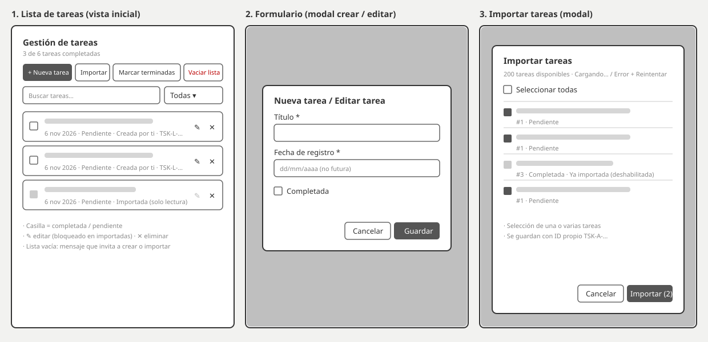

# Gestión de tareas

Aplicación web para gestionar tareas hecha con **HTML + CSS + JavaScript puro**, usando **Web Components con Shadow DOM** y persistencia en **localStorage** (JSON). Permite importar tareas desde la API pública [JSONPlaceholder](https://jsonplaceholder.typicode.com/todos).

Sin frameworks ni dependencias. Todo el proyecto son 5 archivos:

| Archivo | Contenido |
|---|---|
| `index.html` | Página que carga los estilos, el script y la app (`<task-app>`). |
| `styles.css` | Todos los estilos (página y componentes). |
| `app.js` | Toda la lógica y los 3 Web Components. |
| `wireframes.svg` | Wireframes con la propuesta de la interfaz. |
| `README.md` | Esta documentación. |

## Uso

- **Nueva tarea:** abre el formulario modal con título, fecha de registro y completado. El título debe tener al menos 3 caracteres y la fecha no puede ser futura.
- **Casilla de cada tarea:** marca la tarea como completada o pendiente.
- **✎ / ✕:** editar o eliminar una tarea. Eliminar pide confirmación.
- **Importar:** abre un modal con las tareas de la API. Selecciona una o varias (o *Seleccionar todas*) y pulsa *Importar*. Si la API falla, se muestra el motivo y un botón *Reintentar*.
- **Marcar terminadas:** completa todas las tareas pendientes visibles (respeta la búsqueda y el filtro).
- **Vaciar lista:** elimina todas las tareas, con confirmación.
- **Buscador y filtro:** filtran la lista por texto y por estado (*Todas / Pendientes / Completadas*).

Las tareas **importadas son de solo lectura**: su casilla y su botón de editar están deshabilitados y solo se pueden eliminar.

## Ejecución y despliegue

**En local:** basta con abrir `index.html` en el navegador (doble clic). No necesita servidor ni instalación. También funciona con cualquier servidor estático, por ejemplo `python -m http.server`.

**GitHub Pages:**
1. Sube los archivos a un repositorio.
2. Ve a *Settings → Pages*, elige *Deploy from a branch*, la rama `main` y la carpeta `/ (root)`.
3. La app quedará en `https://<usuario>.github.io/<repositorio>/`.

Funciona igual en Netlify o Vercel, porque es un sitio estático sin paso de compilación.

> La importación requiere conexión a internet. El resto funciona sin conexión.

## Lógica implementada

### Web Components

Todos heredan de una clase `Base` que crea el **Shadow DOM** (`attachShadow`) y ofrece un método para emitir eventos.

**Estilos:** los estilos de la página no atraviesan el Shadow DOM. Por eso `styles.css` se enlaza en dos sitios:

- En `index.html`, para la página (`html` y `body`).
- Dentro del Shadow DOM de cada componente, con `<link rel="stylesheet" href="styles.css">`, para los componentes (`:host`, botones, lista, modales).

El navegador descarga el archivo una sola vez y lo reutiliza desde la caché.

| Componente | Responsabilidad |
|---|---|
| `<task-app>` | Componente principal: guarda las tareas, pinta la lista y gestiona botones, buscador y filtro. |
| `<task-form>` | Modal (`<dialog>`) para crear y editar tareas, con validación nativa del navegador. |
| `<task-import>` | Modal (`<dialog>`) que consume la API y permite seleccionar tareas. |

Los modales no modifican los datos. Emiten eventos (`save`, `import`) con `bubbles` y `composed` para atravesar el Shadow DOM, y `<task-app>` los recibe y actualiza la lista. Los botones usan un único listener de `click` que lee el atributo `data-act` del elemento pulsado.

### Datos y persistencia

Las tareas se guardan como un array JSON en `localStorage["tareas"]`:

```json
[
  { "id": "TSK-L-MHN2K8QZ-7F3A", "title": "Comprar café", "date": "2026-11-06", "completed": false, "origin": "local" },
  { "id": "TSK-A-MHN2K9AB-X2P1", "title": "delectus aut autem", "date": "2026-11-06", "completed": false, "origin": "api", "apiId": 1 }
]
```

| Campo | Descripción |
|---|---|
| `id` | Identificador propio (ver abajo). |
| `title` | Título o descripción de la tarea. |
| `date` | Fecha de registro (`AAAA-MM-DD`). |
| `completed` | Estado (booleano). |
| `origin` | `local` (creada por el usuario) o `api` (importada). |
| `apiId` | ID original en la API. Solo existe en las importadas y sirve para evitar duplicados. |

Cada cambio se guarda de inmediato y la lista se vuelve a pintar. Si el contenido guardado está dañado, la app arranca con la lista vacía en lugar de fallar.

### Estándar de identificadores

```
TSK-{ORIGEN}-{MARCA DE TIEMPO}-{ALEATORIO}
     L = local     base 36       4 caracteres
     A = API
```

Ejemplo: `TSK-L-MHN2K8QZ-7F3A`.

- El prefijo indica el origen de la tarea.
- La marca de tiempo permite ordenarlas por momento de creación.
- La parte aleatoria, junto con una comprobación contra los IDs existentes, garantiza que no se repitan.
- Las tareas importadas reciben un ID nuevo de este estándar. Su ID original se conserva en `apiId`.

### Integración con la API

`fetch` a `https://jsonplaceholder.typicode.com/todos` con un tiempo máximo de 10 segundos (`AbortSignal.timeout`). Se controlan estos errores:

- Sin conexión o error de red.
- Tiempo de espera agotado.
- Respuesta HTTP con error (por ejemplo 404 o 500).
- Respuesta que no es JSON o que no es una lista.

En todos los casos se muestra el motivo en el modal junto al botón *Reintentar*. Las tareas ya importadas aparecen deshabilitadas para no duplicarlas.

### UX y accesibilidad

- Solo tema oscuro, con contraste suficiente.
- Diseño responsive: los botones se reorganizan en móvil.
- Modales nativos (`<dialog>`): atrapan el foco y se cierran con `Esc`.
- Etiquetas y `aria-label` en todos los controles, incluidos los botones de icono.
- El foco se conserva tras marcar una tarea.
- Mensajes claros cuando la lista está vacía o ninguna tarea coincide con la búsqueda.
- Los textos se escapan antes de insertarse en el HTML para evitar inyección de código.

## Wireframes


